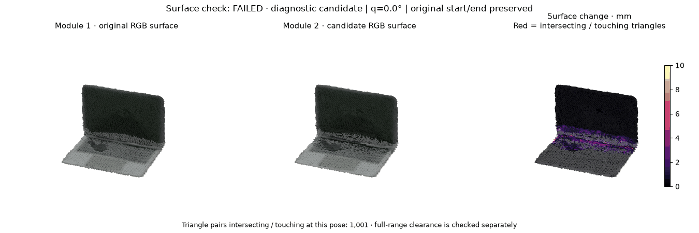

# 历史示例快照

这里保留六个已执行 Jupyter Demo 的历史结果，供比较方法与预期输出。**要输入自己的数据并在服务器运行模块，请打开[六模块运行工作台](live-workbench.md)**；此页的动画不会响应新的输入。

[在当前机器运行六模块](live-workbench.md){ .md-button .md-button--primary }
[使用 Jupyter 运行 Demo](quickstart.md){ .md-button .md-button--primary }
[查看六模块输入输出](../user-guide/index.md){ .md-button }

<!-- demo-verification -->

模块二单独展示本轮联合优化的诊断结果；其余模块使用归档运行快照。候选能否发布以各自的验收结果为准。

当前有两条示例数据线：**实拍 laptop1 → 模块一 → 模块二**；**PartNet-Mobility → 模块三 → 四 → 五 → 六**。模块三尚未使用模块一、二的重建资产。

## 01 · 真实资产与数字孪生

**输入：** laptop1 实拍 RGB-D、起止状态与分割信息。**输出：** 外观重建、部件几何、关节与可重载数字孪生。

动画将外观、重建和提供的参考 USD 放在同一画面，观察部件在起止状态之间的运动和几何对应关系。

<!-- demo-preview:real_assets_and_digital_twin -->

[重建流程与参数](../user-guide/real-assets-and-digital-twin.md) · Notebook：`examples/real_assets_and_digital_twin/demo.ipynb`

## 02 · 物理资产构建

**输入：** 模块一生成的真实重建资产、实拍 RGB-D 视频与 VLM 物性估计。**输出：** 联合优化候选、观测拟合与间隙报告；通过全部验收后生成碰撞代理及 USD 资产。

动画同步对比模块一原始表面、模块二候选表面和变化热图。标定视频约束局部表面及关节轴/原点，start/end 范围保持不变。候选状态和全范围正间隙单独验收；失败候选仅用于诊断，不发布为可用资产。碰撞可行性通过不代表物性已得到独立实测验证。

此处显示模块二最新诊断候选；是否可发布以[当前验收记录](../assets/demos/physical_asset_building/current-validation.json)为准。

[物性、碰撞代理优化与验收](../user-guide/physical-assets.md) · Notebook：`examples/physical_asset_building/demo.ipynb`

## 03 · 场景与任务生成

**输入：** 场景类型、PartNet-Mobility 资产库和自然语言任务。**输出：** 场景布局、任务脚本、机械臂轨迹与任务验收结果。

四组 Blender 动画分别展示家居关笔记本、桌面关瓶盖、货架关柜门和工业区关保险柜门；场景、目标物体、自然语言任务和关节初态由同一任务配置关联，执行结果按三项门控进入成功或失败样本库。

<!-- demo-preview:scene_and_task_generation -->

[场景布局与任务配置](../user-guide/scenes-and-tasks.md) · Notebook：`examples/scene_and_task_generation/demo.ipynb`

## 04 · 物理仿真与多模态数据

**输入：** 模块三的场景、任务和机械臂动作轨迹。**输出：** 同步观测、动作、状态、接触数据，以及带成功/失败标签的 Episode。

左侧是执行回放，中间是 XYZRGB 点云，右侧为 RGB、米制深度、实例/部件 Mask 和事件预览，下方为关节、接触力和动作曲线。

<!-- demo-preview:simulation_and_data_generation -->

这张动画由同一组记录位姿驱动 Blender PBR 场景进行离线重渲染。训练 Episode 保存的原生相机数组来自所选物理后端；动画不会替换训练数据。

[仿真后端与传感器格式](../user-guide/simulation-and-data-generation.md) · Notebook：`examples/simulation_and_data_generation/demo.ipynb`

## 05 · 数据管理与模型训练

**输入：** 多模态 Episode、动作状态序列、任务与成败标签。**输出：** 数据集快照与划分、ACT/IQL 策略权重、DINO-WM 世界模型及训练评测报告。

动画对照留出轨迹的真实观测与世界模型预测；数据面板展示同步模态、动作状态和数据划分。

<!-- demo-preview:data_management_and_training -->

查看数据集与多模态样本面板

<!-- demo-image:data_management_and_training:dataset-preview.png -->

OpenVLA-OFT 与 TD-MPC2 当前输出官方训练交接接口；接口就绪不等同于已完成模型训练。

[数据组织、训练与评测](../user-guide/data-management-and-training.md) · Notebook：`examples/data_management_and_training/demo.ipynb`

## 06 · 评测与反馈闭环

**输入：** 策略模型、部署/评测轨迹、失败案例与指标。**输出：** 评测报告、失败样本、专家恢复示范、更新策略及晋升门禁结果。

同步动画比较失败策略、专家恢复与更新策略；面板展示成功率、轨迹误差、接触指标和失败诊断。流程执行完成与候选策略通过晋升门禁是两个独立结果。

<!-- demo-preview:evaluation_and_feedback -->

查看评测指标与候选策略门禁

<!-- demo-image:evaluation_and_feedback:feedback-dashboard.png -->

当前示例使用仿真轨迹。真机参数校准仍需真实采集证据，不能将仿真回放视为真机验证。

[评测、恢复示范与反馈门禁](../user-guide/evaluation-and-feedback.md) · Notebook：`examples/evaluation_and_feedback/demo.ipynb`

## 下一步：自己运行

[Jupyter 入门与运行](quickstart.md)介绍如何选内核、按依赖运行六个 Notebook、打开已执行副本，以及排查没有图像或内核不一致的问题。
