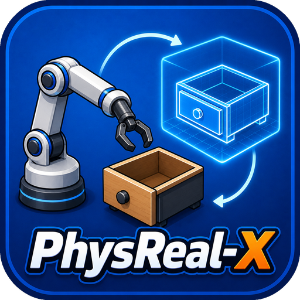

<div class="prx-intro" markdown>



<div markdown>

# PhysReal-X 用户指南

PhysReal-X 是位于物理引擎之上的具身智能实验平台。它以统一、不可变的契约连接数字资产、仿真任务、轨迹数据、模型训练和独立评测，使每次实验都可以校验、追溯和复现。

[快速开始](getting-started/quickstart.md){ .md-button .md-button--primary }
[安装环境](getting-started/installation.md){ .md-button }

</div>

</div>

!!! note "当前版本"
    `0.1` 已跑通抽屉任务的完整参考闭环：资产与任务注册、确定性数据生成、数据集发布、CUDA 行为克隆训练和新种子评测。尚未通过契约测试的外部仿真器与真实机器人不会被标记为已支持。

## 入门

<div class="grid cards prx-doc-cards" markdown>

-   :material-download:{ .lg .middle } **安装与环境**

    ---

    创建 Python 或 Conda 环境，检查可选 CUDA 运行时，并验证安装结果。

    [开始安装](getting-started/installation.md)

-   :material-rocket-launch-outline:{ .lg .middle } **快速开始**

    ---

    使用一个命令生成轨迹、训练策略并完成独立评测。

    [运行参考闭环](getting-started/quickstart.md)

</div>

## 用户指南

<div class="grid cards prx-doc-cards" markdown>

-   :material-cube-outline:{ .lg .middle } **资产与任务**

    ---

    了解 `AssetSpec`、`TaskSpec`、信号定义、动作边界和成功条件。

    [定义实验输入](user-guide/assets-and-tasks.md)

-   :material-source-branch:{ .lg .middle } **数据生成、训练与评测**

    ---

    从 `RunSpec` 到 `DatasetManifest`、`ModelManifest` 和评测报告。

    [执行完整工作流](user-guide/workflow.md)

</div>

## 核心概念

<div class="grid cards prx-doc-cards" markdown>

-   :material-sitemap-outline:{ .lg .middle } **平台架构**

    ---

    理解领域、契约、应用、适配器和用户接口之间的依赖方向。

    [阅读架构说明](ARCHITECTURE.md)

-   :material-file-check-outline:{ .lg .middle } **数据契约**

    ---

    理解 Episode 时间语义、内容寻址、版本血缘和原子发布。

    [阅读数据契约](concepts/data-contracts.md)

-   :material-puzzle-outline:{ .lg .middle } **插件与适配器**

    ---

    按统一生命周期接入仿真器、策略和训练器。

    [阅读接入规则](concepts/plugins.md)

</div>

## 接口与开发

| 内容 | 适合场景 |
| --- | --- |
| [命令行参考](reference/cli.md) | 初始化工作区、校验规格、运行实验和检查资源 |
| [Python 接口](reference/python-api.md) | 将平台工作流嵌入研究代码或上层服务 |
| [开发与测试](development.md) | 修改核心代码、运行质量门禁和构建文档 |
| [能力边界与路线图](roadmap.md) | 判断当前支持范围以及外部能力接入顺序 |

## 平台工作流

```text
资产规格 + 任务规格
        ↓
解析版本、摘要和随机种子
        ↓
仿真后端 + 策略
        ↓
Episode → 数据集清单
        ↓
训练器 → 模型清单
        ↓
独立评测 → 失败案例
```

平台只负责统一控制面、数据面和验证语义；具体物理计算、视觉重建和机器人控制由通过契约测试的外部适配器负责。
