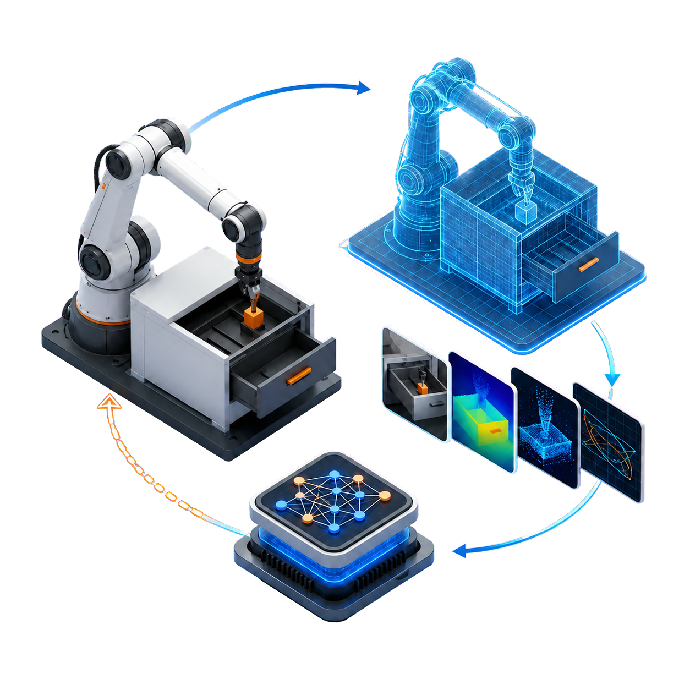

<div class="prx-home" markdown>

<section class="prx-hero" markdown>

<div class="prx-hero__copy" markdown>

<p class="prx-eyebrow">具身智能数据与实验平台</p>

# 把真实资产、仿真数据与机器人学习连成一条实验链路

PhysReal-X 统一描述和编排数字孪生、场景任务、仿真执行、Episode 数据、策略训练、独立评测与真机反馈；只有通过能力注册和证据门禁的阶段才能执行与发布。

<div class="prx-actions">
  <a class="md-button md-button--primary" href="getting-started/quickstart/">快速开始</a>
  <a class="md-button" href="api/">浏览 API</a>
</div>

<div class="prx-hero__proof" role="list">
  <div role="listitem"><strong>统一契约</strong><span>资产、任务、数据与模型语义一致</span></div>
  <div role="listitem"><strong>多后端</strong><span>统一接入仿真、训练与机器人后端</span></div>
  <div role="listitem"><strong>全程可追溯</strong><span>版本、环境、种子与结果完整关联</span></div>
</div>

</div>

<div class="prx-hero__visual" role="img" aria-label="真实工作站、数字孪生、多模态数据与机器人策略构成闭环">
  <div class="prx-hero__halo" aria-hidden="true"></div>
  
  <div class="prx-hero__node prx-hero__node--reality"><span>01</span>真实工作站</div>
  <div class="prx-hero__node prx-hero__node--twin"><span>02</span>数字孪生</div>
  <div class="prx-hero__node prx-hero__node--data"><span>03</span>多模态数据</div>
  <div class="prx-hero__node prx-hero__node--policy"><span>04</span>机器人策略</div>
</div>

</section>

<nav class="prx-entry-strip" aria-label="文档快捷入口">
  <a href="getting-started/"><span>01</span><strong>入门</strong><small>完成安装、环境配置与首个契约实验</small></a>
  <a href="user-guide/"><span>02</span><strong>用户指南</strong><small>掌握资产、仿真、数据、训练与部署流程</small></a>
  <a href="api/"><span>03</span><strong>API 文档</strong><small>查询资源模型、服务方法与错误语义</small></a>
</nav>

<section class="prx-section">

<div class="prx-section__heading">
  <span>平台能力</span>
  <h2>面向从真实世界到真机反馈的完整链路</h2>
  <p>各环节通过可验证资源、明确生命周期和可追溯输入输出组合；缺失方法或科学证据时会显式阻断。</p>
</div>

<div class="prx-capability-grid">
  <a class="prx-capability-item" href="user-guide/real-assets-and-digital-twin/">
    <span class="prx-capability-index">01</span>
    <h3>真实资产接入与数字孪生</h3>
    <p>导入 RGB-D 与点云，恢复相机、米制尺度、深度、视觉几何、部件和关节。</p>
    <span class="prx-capability-arrow" aria-hidden="true">→</span>
  </a>
  <a class="prx-capability-item" href="user-guide/physical-assets/">
    <span class="prx-capability-index">02</span>
    <h3>物理可信资产构建</h3>
    <p>构建碰撞体、辨识物性、组装并验证可供仿真使用的 OpenUSD 资产。</p>
    <span class="prx-capability-arrow" aria-hidden="true">→</span>
  </a>
  <a class="prx-capability-item" href="user-guide/scenes-and-tasks/">
    <span class="prx-capability-index">03</span>
    <h3>场景与任务生成</h3>
    <p>组合机器人、物体与传感器，声明观测、动作、初态、目标和确定性成功条件。</p>
    <span class="prx-capability-arrow" aria-hidden="true">→</span>
  </a>
  <a class="prx-capability-item" href="user-guide/simulation-and-data-generation/">
    <span class="prx-capability-index">04</span>
    <h3>物理仿真与多模态数据生成</h3>
    <p>执行物理轨迹并同步生成图像、深度、点云、接触、状态、动作与 Episode。</p>
    <span class="prx-capability-arrow" aria-hidden="true">→</span>
  </a>
  <a class="prx-capability-item" href="user-guide/data-management-and-training/">
    <span class="prx-capability-index">05</span>
    <h3>数据管理与模型训练</h3>
    <p>质检并版本化 Episode，训练策略、VLA 和世界模型，登记可加载权重。</p>
    <span class="prx-capability-arrow" aria-hidden="true">→</span>
  </a>
  <a class="prx-capability-item" href="user-guide/evaluation-and-feedback/">
    <span class="prx-capability-index">06</span>
    <h3>评测与真机反馈闭环</h3>
    <p>执行固定基准和分级部署，通过遥测、失败归因和定向数据集持续改进。</p>
    <span class="prx-capability-arrow" aria-hidden="true">→</span>
  </a>
</div>

</section>

<section class="prx-section prx-section--workflow">

<div class="prx-section__heading">
  <span>标准工作流</span>
  <h2>一次定义，贯穿生成、训练与部署</h2>
  <p>资源在进入运行前解析为精确版本；结果通过质量检查后才发布，失败不会留下可见的半成品。</p>
</div>

<div class="prx-workflow" aria-label="PhysReal-X 标准工作流">
  <div><span>01</span><strong>接入并重建</strong><small>观测、相机、几何与关节</small></div>
  <div><span>02</span><strong>构建物理资产</strong><small>碰撞、物性与 USD</small></div>
  <div><span>03</span><strong>定义场景任务</strong><small>布局、观测、动作与目标</small></div>
  <div><span>04</span><strong>生成仿真数据</strong><small>渲染、传感器与 Episode</small></div>
  <div><span>05</span><strong>管理数据并训练</strong><small>快照、策略与世界模型</small></div>
  <div><span>06</span><strong>评测与真机回流</strong><small>基准、部署、归因与补数</small></div>
</div>

</section>

<section class="prx-sdk" markdown>

<div class="prx-sdk__copy" markdown>

<p class="prx-eyebrow">统一 Python SDK</p>

## 统一资源语义，贯通资产、仿真、数据与训练

业务代码只面向平台资源与任务生命周期；仿真器、训练框架和机器人由平台工作节点统一接入与调度。

[阅读快速开始](getting-started/quickstart.md) · [查看客户端约定](api/client.md)

</div>

<div class="prx-sdk__code" markdown>

```python
from physrealx import PhysRealX
from physrealx.reference import reference_asset, reference_run, reference_scene, reference_task

px = PhysRealX.open(".physrealx")
asset = reference_asset()
scene = reference_scene(asset)
task = reference_task(scene)
px.assets.register(asset)
px.scenes.register(scene)
px.tasks.register(task)

run = px.runs.submit(reference_run(scene, task, episode_count=8))

dataset = px.datasets.get(px.runs.wait(run).dataset)
```

</div>

</section>

<section class="prx-final-cta" markdown>

<p class="prx-eyebrow">开始使用</p>

## 用一个可复现实验认识 PhysReal-X

从安装环境开始，注册资产、定义场景任务、运行确定性参考后端，并把结果交给参考训练与评测服务。

<div class="prx-actions prx-final-cta__actions">
  <a class="md-button" href="getting-started/installation/">安装与环境</a>
  <a class="md-button md-button--primary" href="getting-started/first-project/">开始第一个项目</a>
</div>

</section>

</div>
