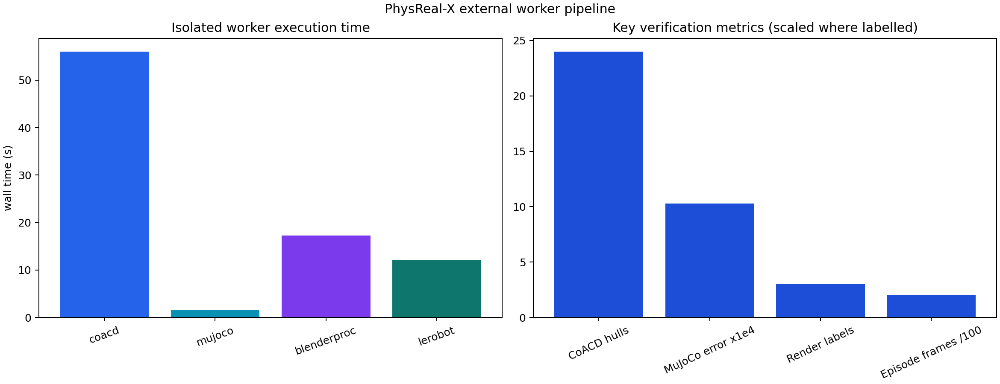
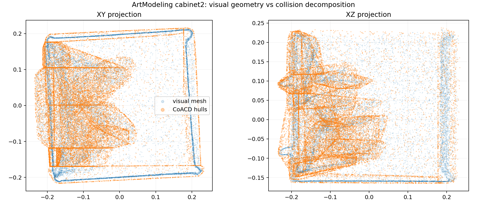
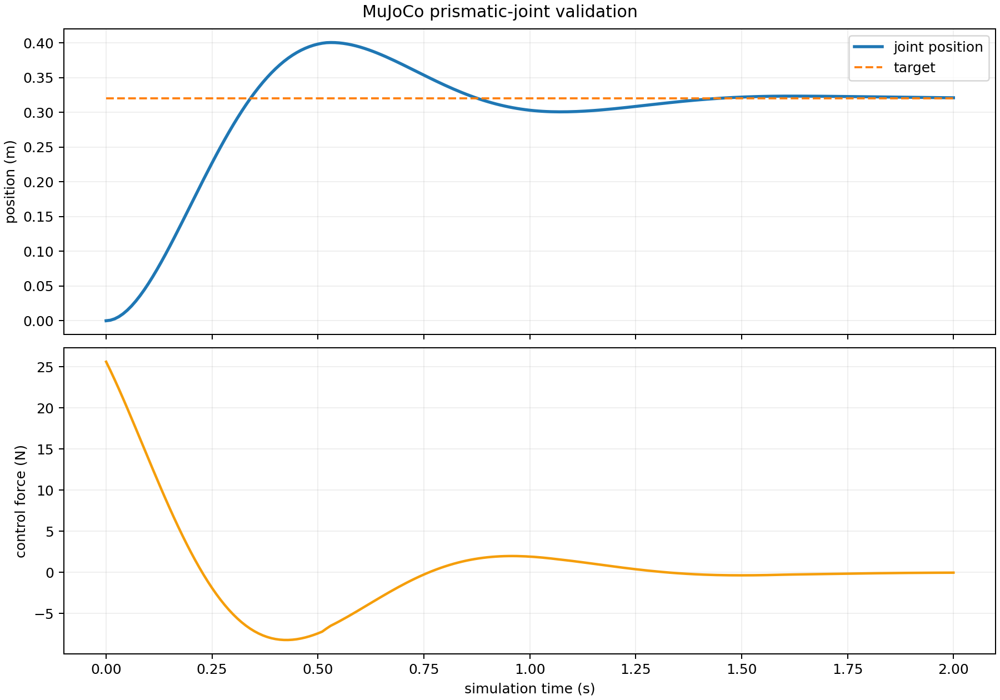
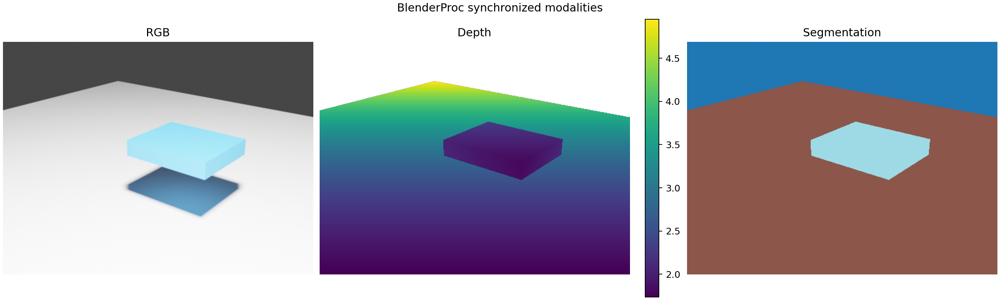

# 外部方法与实验验证

算法环境与 PhysReal-X 核心环境彻底分离。平台通过工作区的 `workers.d` 加载方法描述符、执行命令和环境锁；每次执行均验证输入摘要、输出契约、资源限制与环境就绪状态。

## 安装和就绪检查

```bash
python workers/install.py \
  --root /data/physrealx-workers/envs \
  --workspace /data/physrealx-workspace \
  --blender-runtime /data/blender/blender-4.2.1-linux-x64 \
  coacd mujoco blenderproc lerobot
```

```python
from physrealx import PhysRealX

px = PhysRealX.open("/data/physrealx-workspace")
for installation in px.methods.installations():
    print(installation.descriptor.name, installation.ready, installation.detail)
```

只有探测通过的 worker 才可执行。未安装方法、被篡改的环境锁或不匹配的 NumPy 版本都会在运行前失败。

已有环境位于只读介质或镜像层时，可只重新生成环境证明和工作区部署绑定：

```bash
python workers/install.py --register-only \
  --root /data/physrealx-workers/envs \
  --workspace /data/physrealx-workspace \
  --blender-runtime /data/blender/blender-4.2.1-linux-x64 \
  coacd mujoco blenderproc lerobot
```

## cabinet2 验证链

本项目使用 ArtModeling `cabinet2` 的已重建可视 Mesh 验证外部执行边界：

`whole_mesh.ply → CoACD 凸分解 → MuJoCo 抽屉关节轨迹 → BlenderProc RGB/Depth/Mask → LeRobot v2.1 Episode`

> **验证边界**：该链路验证外部算法的可执行性、协议一致性与制品可追溯性，不等价于 Ditto 部件/关节恢复或真机物性辨识。这些能力需要对应观测、检查点和独立 worker 才能声明完成。

## 实验结果

以下数值来自空操作缓存的冷启动验证；输入 Mesh 的 SHA-256 为
`eea9dbfb…b4ac`。完整机器可读证据见
[`cabinet2-external-workers.json`](https://github.com/bupt-yxp/PhysReal-X/blob/main/experiments/results/cabinet2-external-workers.json)。

| 阶段 | 实际输出与定量结果 | 冷启动耗时 |
| --- | --- | ---: |
| CoACD 1.0.14 | 117,327 顶点、230,828 面输入生成 24 个凸体；输出 2,215 顶点、4,334 面 | 56.02 s |
| MuJoCo 3.12.0 | 2.002 s 仿真、201 个样本；稳定且未越界，末端关节误差 1.03 mm | 1.57 s |
| BlenderProc 2.8.0 | 512×384 RGB/Depth/Segmentation；3 个标签，有效深度 75.89%，范围 1.733–4.953 m | 17.29 s |
| LeRobot 0.3.3 | 1 个 v2.1 Episode、201 帧、100 Hz；Parquet 与元数据经 LeRobot 重新加载验证 | 12.14 s |

源网格不是封闭流形，因此不报告无物理意义的源体积比；CoACD 结果仍需在最终关节模型和真实接触任务中继续验证。









实验页只展示可由证据 JSON、操作引用和制品 SHA-256 重建的结果。BlenderProc 图验证的是同一状态轨迹下的同步模态渲染适配器，不代表 cabinet2 已完成 Ditto 关节恢复、物性辨识或真机一致性验收。
