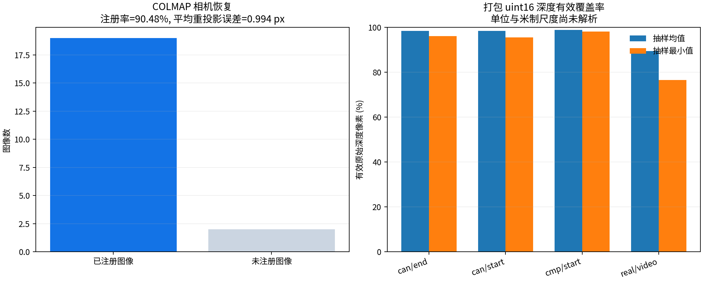
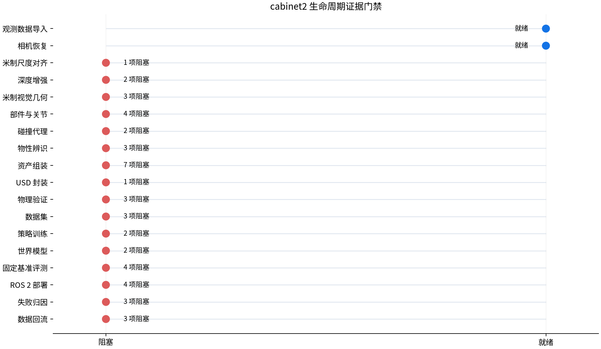

# 外部方法与证据门禁

外部算法与 PhysReal-X 核心环境完全分离。平台通过工作区 `workers.d` 加载固定的
方法描述符、执行命令和环境证明，且只把完整、版本化、可验证的资源闭包交给 worker。

## 方法就绪不等于名称存在

```python
from physrealx import MethodCapability, PhysRealX

px = PhysRealX.open("/data/physrealx-workspace")
installation = px.methods.inspect(MethodCapability.CAMERA_RECOVER, "colmap")
if not installation.ready:
    raise RuntimeError(installation.detail)
```

就绪判定同时要求：

1. 能力、方法名、版本、API 版本及输入输出契约一致；
2. 固定源码 revision、权重摘要、Python/CUDA 与运行时文件摘要完整；
3. `--probe` 实际加载关键依赖，有权重的方法还要执行固定小样本；
4. 请求中的资源及全部 `ArtifactRef` 形成闭包，Schema、大小和 SHA-256 通过验证。

因此，文档中的 `method="ditto"` 或 `method="omni_dc"` 是选择已安装方法，
不是让核心包自动下载算法，更不是在算法缺失时使用占位结果。

## 资产链参考 worker

| 阶段 | 方法 | 不可省略的证据 |
| --- | --- | --- |
| 相机恢复 | `colmap` | 原始多视角图像、采样规则、已登记观测集；无米制尺度锚点时明确输出 `unresolved` |
| 米制对齐 | `metric_alignment` | 绑定未定尺相机的实测 3D 对应、度量基准与独立留出集 |
| 深度增强 | `omni_dc` | 米制标定、稀疏深度、互斥留出深度、固定官方权重 |
| 几何重建 | 未注册 | 已解析米制相机、已验证深度与新生成的每 link 视觉 Mesh |
| 关节恢复 | `ditto` | 同一米制坐标系的真实交互前后点云、静态/运动留出点、固定权重 |
| 碰撞构建 | `coacd` | 已分部件视觉 Mesh；碰撞 Mesh 不得反向当作视觉几何 |
| 单关节物性辨识 | `physrealx_mujoco_sysid_adapter` | 实测 q/qdot、作用量、训练-留出分割与充分激励；不辨识 link 质量惯量 |
| 资产组装 | 未注册 | 每 link 视觉/碰撞几何、关节树、完整 body/joint 物性与闭包证据 |
| USD 封装 | `openusd` | 已解析米制尺度、部件关节、视觉/碰撞几何、已辨识物性与所有依赖 |

详细输入与探针要求见[米制对齐 worker](../api/metric-alignment-worker.md)、
[OMNI-DC worker](../api/omnidc-worker.md) 和
[Ditto worker](../api/ditto-worker.md)。

## cabinet2 可执行证据实验

```bash
python experiments/run_cabinet2_evidence.py \
  --source /data/ArtModeling/cabinet2 \
  --workspace /data/physrealx-workspace \
  --output /data/physrealx-experiment
```

该实验会对源包预检、内容寻址导入、深度帧格式/覆盖率分析和真实 COLMAP 恢复生成
机器可读报告与就绪可视化。它依据证据门禁停在第一个未满足的阶段：COLMAP
只完成未定尺相机恢复；米制对齐必须另行提供 marker 字典、边长、布局或等价度量证据。
未解析米制尺度会阻止深度、Ditto 和 USD 阶段。

固定抽样实验实际导入 `1,149` 个文件、`2,016,218,738` 字节；COLMAP 从
`can.start` 选择 21 帧并注册 19 帧，注册率为 `90.48%`，生成 273 个稀疏点，
平均轨迹长度为 `5.667`，平均重投影误差为 `0.994 px`。四组原始深度抽样的平均
有效覆盖率分别为 `98.47%`、`98.47%`、`98.90%` 和 `89.48%`；这些数值只说明
原始像素覆盖情况，不代表深度单位、米制尺度或补全精度已经验证。





`sim/`、历史 USD、人工运动轨迹和固定标量 Episode 只能作为候选先验，不能冒充真实
关节恢复、物性辨识、多模态生成或策略训练结果。缺失证据时的正确结果是可解释的
`BLOCKED`，而不是发布半成品。
