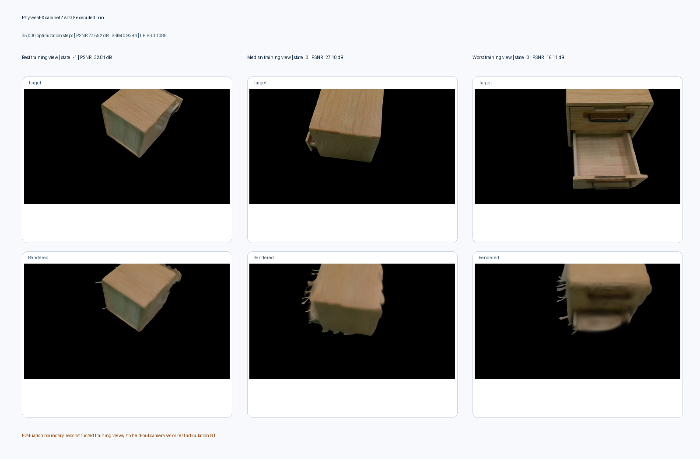
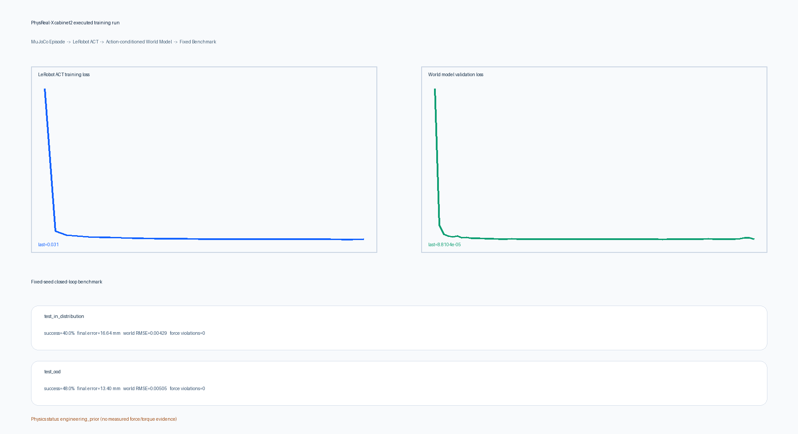

# cabinet2 实际训练证据

本目录保存真实执行产生的数据、日志、权重、指标和可视化，不是单元测试夹具。

## 已执行结果

| 链路 | 实际执行 | 结果 |
| --- | --- | --- |
| ArtGS 资产学习 | 10,000 次粗模型、5,000 次部件/关节类型、20,000 次联合优化 | 20,448 个 Gaussian；预测 `s,p,p`；PSNR 27.592 dB、SSIM 0.9394、LPIPS 0.1086 |
| MuJoCo 数据生成 | 96/24/24/24 个训练、验证、常规测试、OOD Episode，每个 80 步 | 专家生成成功率均为 100%；训练主集 7,680 帧 |
| LeRobot ACT | 600 次真实反向传播，221K 参数 | loss 由 9.971 降至 0.031；权重已保存 |
| 动作条件世界模型 | 71 个 epoch | 独立验证归一化 MSE `7.6573e-05`；权重已保存 |
| 固定闭环评测 | 常规与 OOD 各 25 个未参与训练的固定 Episode | 成功率 40% / 48%；平均末端误差 16.64 / 13.40 mm；力限制违规为 0 |





## 可复核产物

- `run_manifest.json`：登记执行脚本、ArtGS 报告、环境、数据树和结果文件。
- `artgs_training_report.json`：绑定 ArtGS 源码树、子模块、权重、Gaussian 和全部导出 Mesh。
- `policy_training_report.json`、`world_model_training_report.json`：训练步数、耗时、指标与权重文件。
- `benchmark_report.json`：50 个逐 Episode 固定评测结果。
- `lerobot_dataset.tar`：100 个文件的 LeRobot v2.1 数据快照。
- `raw_episodes.tar`：168 个 MuJoCo Episode 文件。
- `artifacts/`：可直接加载的 ACT 与世界模型权重及配置。

完整大体积 ArtGS 权重、Gaussian、Mesh 与 2,676 个渲染文件位于：

```text
/mnt/53dad72e-a787-4c09-961e-eff73e08888e/yxp/PhysReal-X-training/
├── cabinet2-artgs-real-20260830/
└── cabinet2-learning-final-20260830/
```

## 科学边界

`artgs_training_report.json` 产生于 ArtGS 归入主仓库之前，因此保留当时的外部源码路径作为历史执行证据；它不是当前 `geometry.reconstruct:artgs` 的合格输出，不会被平台提升为可训练资产。新执行仅使用 `algorithms/artgs/` 的固定源码树。

ArtGS 指标来自重建训练视图，因为数据没有独立测试相机集和真实关节变换标注；MuJoCo
训练使用 `sim/` 中信息构造并随机化的工程先验，不是从真机力/力矩轨迹辨识出的物性。
因此这些结果证明算法训练、权重保存、推理和闭环评测已实际运行，但不能替代米制对齐、
真实物性辨识、完整 USD 验收或 ROS 2 真机实验。
